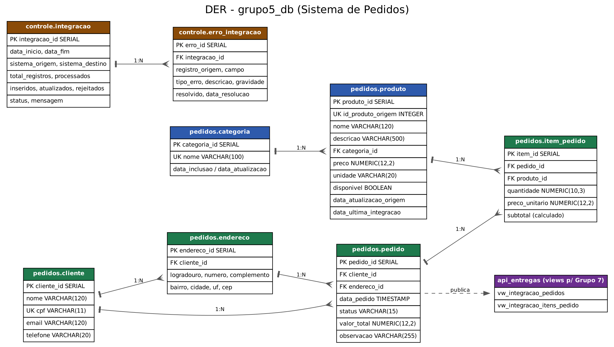

# Modelo do Banco de Dados — grupo5_db

## Organização em schemas

| Schema | Conteúdo | Quem acessa |
|---|---|---|
| `pedidos` | 6 tabelas de negócio (categoria, produto, cliente, endereco, pedido, item_pedido) | `grupo5_app` (CRUD) |
| `controle` | Registro das execuções (`integracao`), dos erros (`erro_integracao`) e das versões do contrato (`historico_contrato`) | `grupo5_app` |
| `api_entregas` | Views publicadas para o Grupo 7 | `grupo7_integracao` (só SELECT) e `grupo5_app` |

## Usuários e permissões

| Usuário | Papel | Permissões |
|---|---|---|
| `grupo5_owner` | Dono do banco | Cria e altera a estrutura (DDL) |
| `grupo5_app` | Aplicação do Grupo 5 | SELECT/INSERT/UPDATE/DELETE em `pedidos`; SELECT/INSERT/UPDATE em `controle`; SELECT em `api_entregas`. Não pode criar, alterar ou apagar tabelas |
| `grupo7_integracao` | Consumidor (Grupo 7) | CONNECT no banco, USAGE em `api_entregas` e SELECT nas duas views. Nada mais |
| `grupo3_app` | Credencial que o **Grupo 3** cria para nós no banco deles | SELECT em `public.vw_integracao_produtos` |

## Dicionário das tabelas de negócio

**categoria** — criada a partir do campo texto `categoria` do Grupo 3. Como o Grupo 3 não envia código de categoria, o nome é único (índice em `lower(nome)`).

**produto** — catálogo recebido do Grupo 3. `id_produto_origem` (UNIQUE) guarda o `id_produto` do Grupo 3. Tamanhos iguais aos do contrato: nome VARCHAR(120), descrição VARCHAR(500), preço NUMERIC(12,2), unidade VARCHAR(20). `disponivel` = FALSE quando o produto está inativo ou sumiu da origem. `data_atualizacao_origem` guarda a data informada pelo produtor e `data_ultima_integracao` a última vez que a integração passou pelo registro. `CHECK (preco > 0)`.

**cliente** — `cpf` com 11 dígitos e UNIQUE; e-mail validado por expressão regular.

**endereco** — endereços de entrega do cliente (1:N). `uf` com 2 letras maiúsculas e `cep` com 8 dígitos.

**pedido** — status `ABERTO`, `CONFIRMADO` ou `CANCELADO`. `valor_total` é recalculado por trigger. Trigger impede usar endereço de outro cliente e confirmar pedido sem itens.

**item_pedido** — `preco_unitario` é copiado do produto no momento da inclusão (o preço fica "congelado" mesmo que o Grupo 3 reajuste depois). `subtotal` é coluna calculada. Trigger impede incluir produto indisponível e mexer em itens de pedido já confirmado. `UNIQUE (pedido_id, produto_id)`.

## Chaves estrangeiras

| Tabela | Coluna | Referencia | Ao excluir o pai |
|---|---|---|---|
| produto | categoria_id | categoria | bloqueia |
| endereco | cliente_id | cliente | apaga os endereços (CASCADE) |
| pedido | cliente_id | cliente | bloqueia |
| pedido | endereco_id | endereco | bloqueia |
| item_pedido | pedido_id | pedido | apaga os itens (CASCADE) |
| item_pedido | produto_id | produto | bloqueia |
| erro_integracao | integracao_id | integracao | bloqueia |

Todas as tabelas de negócio têm `data_inclusao` e `data_atualizacao`; esta última é mantida por trigger e permite ao Grupo 7 identificar alterações.
